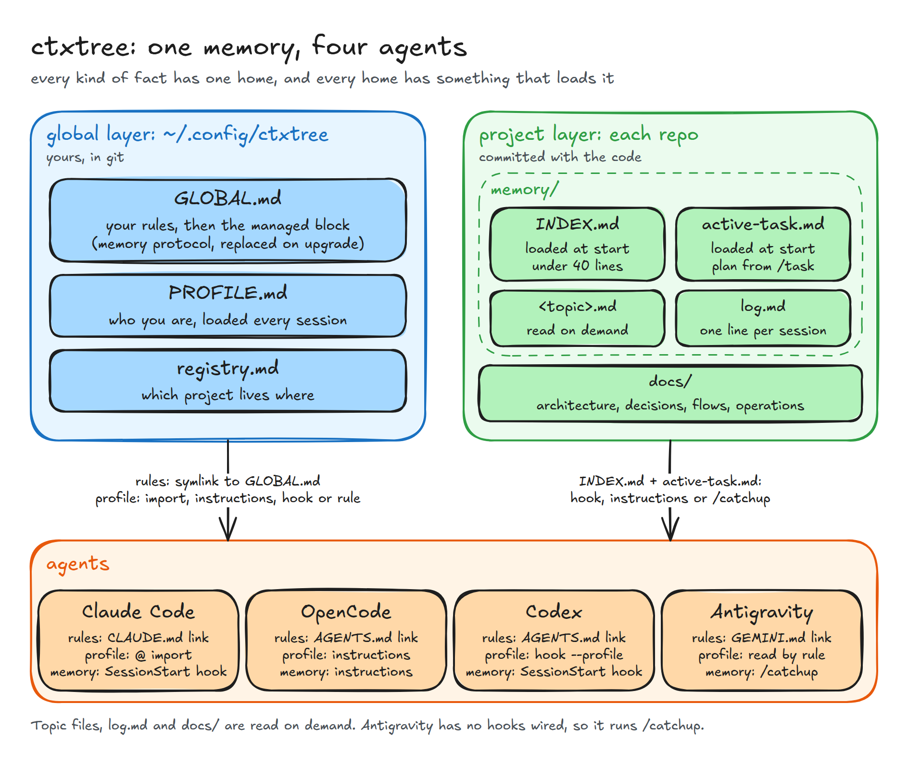
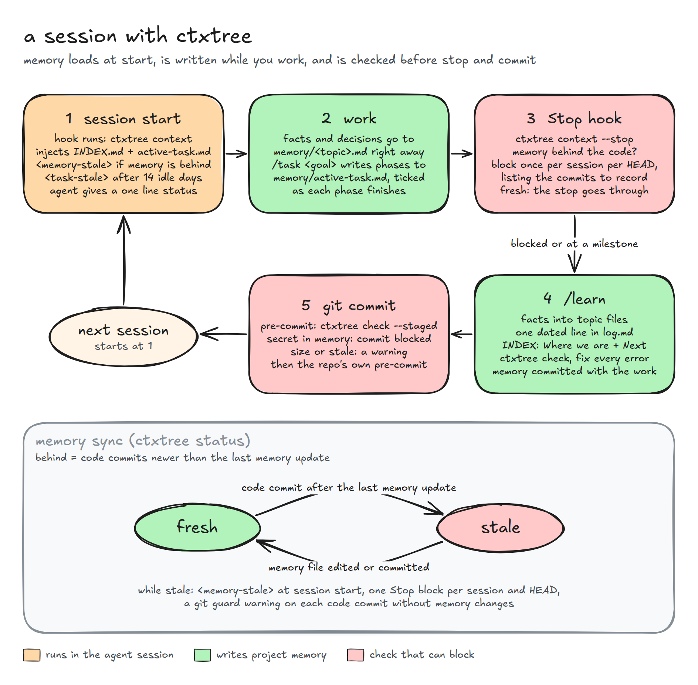
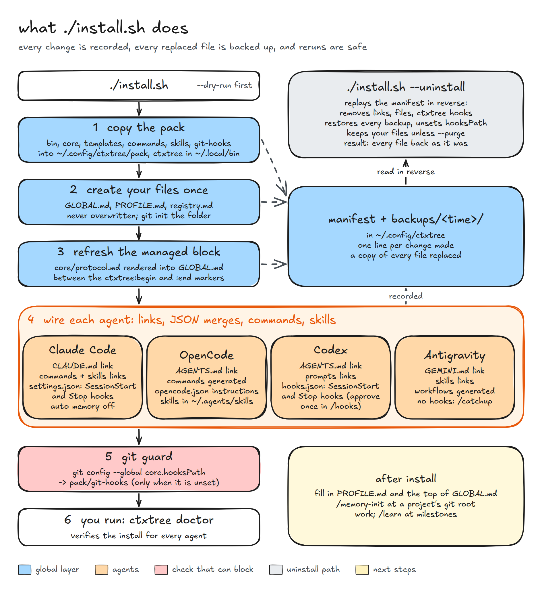

<p align="center">
  
</p>

<h1 align="center">ctxtree</h1>

<p align="center"><b>One memory for every coding agent.</b></p>

<p align="center">
  <a href="https://github.com/tsvlgd/ctxtree/actions/workflows/test.yml"></a>
  
  <a href="LICENSE"></a>
</p>

<p align="center">
  <a href="#install">Install</a> &middot;
  <a href="#quick-start">Quick start</a> &middot;
  <a href="#supported-agents">Agents</a> &middot;
  <a href="#how-it-works">How it works</a> &middot;
  <a href="#commands">Commands</a> &middot;
  <a href="docs/">Docs</a>
</p>

Coding agents forget everything between sessions, and each one keeps its own private, duplicated notes. **ctxtree** gives Claude Code, OpenCode, Codex and Antigravity the same memory: plain Markdown in your repo, loaded automatically, kept in sync with the code.

- **Shared:** one `memory/` tree per repo and one set of global rules and profile, read by every agent. No database, no memory server.
- **Automatic:** hooks and instruction lists put the right files in context at session start, after `/clear` and after compaction.
- **In sync:** when code moves ahead of memory, agents are told at session start, asked once before stopping, and warned at commit.
- **Guarded:** secrets in memory block the commit, size limits keep context lean, and global files change only when you say so.

## Install

Point your agent at the repo and let it do the work. It runs a dry run, explains every change, and asks you once:

```text
Install ctxtree on this machine by following INSTALL.md in https://github.com/tsvlgd/ctxtree
```

Or by hand, on Linux, macOS or Windows (Git Bash):

```bash
git clone https://github.com/tsvlgd/ctxtree && cd ctxtree
./install.sh --dry-run    # see every change first
./install.sh              # wires every agent it finds
ctxtree doctor            # verify
```

<details>
<summary><b>Requirements and platform notes</b></summary>

The installer needs bash, git and jq. At runtime ctxtree needs only bash (3.2 or later) and git.

| Platform | Notes |
| --- | --- |
| Linux | any bash, GNU or busybox tools |
| macOS | the built in bash 3.2 works; jq ships with macOS 15 and later (`brew install jq` before that) |
| Windows | run from Git Bash. Install jq with `winget install jqlang.jq`. With Developer Mode on you get real symlinks; without it the installer writes managed copies that ctxtree refreshes at every session start. Codex hooks go through a `ctxtree.cmd` shim so they run in Git Bash, never WSL |

</details>

<details>
<summary><b>Installer options</b></summary>

| Option | Effect |
| --- | --- |
| `--agents claude,opencode,codex,antigravity` | wire only these (default: every agent whose config folder exists) |
| `--dry-run` | print every action, change nothing |
| `--verbose` | print every action while installing (default: a short summary, full list in `~/.config/ctxtree/install.log`) |
| `--link` | link the pack to this checkout (for hacking on ctxtree) |
| `--claude-plugin` | let the Claude Code plugin provide commands, skills and hooks |
| `--keep-auto-memory` | leave Claude Code auto memory on |
| `--no-git-hook`, `--no-git` | skip the global pre-commit guard, or git for the global folder |
| `--uninstall [--purge]` | undo everything from the manifest and restore backups |

Every file the installer replaces is backed up under `~/.config/ctxtree/backups/`, and running it again changes nothing.

</details>

<details>
<summary><b>Claude Code plugin</b></summary>

```bash
./install.sh --claude-plugin
```

Then in Claude Code: `/plugin marketplace add tsvlgd/ctxtree` and `/plugin install ctxtree@ctxtree`.

</details>

## Quick start

In a project, at its git root, ask your agent to `/memory-init`, or do it yourself:

```console
$ ctxtree init api web
created AGENTS.md
registry row added in ~/.config/ctxtree/registry.md
created memory/ for myapp: INDEX.md, log.md, archive/ and api web
```

Work as usual. When the code moves on and memory does not, every session knows:

```console
$ ctxtree status
stale 1
$ ctxtree context   # what the SessionStart hook injects
<project-memory root="~/code/myapp" trigger="startup">
<memory-stale>
Memory was last updated 2026-11-22 19:23, but 1 commit(s) changed the code since:
  2026-11-22 d821940 feat: add checkout
...
```

Run `/learn` at milestones, `/task <goal>` for anything with more than three steps, and `/catchup` when you come back.

## Supported agents

| | Claude Code | OpenCode | Codex | Antigravity |
| --- | --- | --- | --- | --- |
| Global rules | `CLAUDE.md` link | `AGENTS.md` link | `AGENTS.md` link | `GEMINI.md` link |
| Your profile | import | instructions | hook | read at start |
| Project memory | SessionStart hook | instructions | SessionStart hook | `/catchup` |
| Stays in sync | start + Stop hooks, git | git, `/catchup` | start + Stop hooks, git | git, `/catchup` |
| Commands | `/learn` | `/learn` | `/prompts:learn` | `/learn` workflow |

> [!NOTE]
> Codex asks you to approve new hooks once in `/hooks`. Antigravity hooks are not wired yet because their format is not documented. `~/.gemini/GEMINI.md` is also read by Gemini CLI.

## How it works

<p align="center">
  
</p>
<p align="center"><i>One home per kind of fact, and one loader per home.</i></p>

| Fact | Home | Loaded |
| --- | --- | --- |
| How agents behave | `~/.config/ctxtree/GLOBAL.md` | every session, every agent |
| Who you are | `~/.config/ctxtree/PROFILE.md` | every session |
| Project decisions, state, ids | `memory/<topic>.md` | when the task needs it |
| Where the project stands | `memory/INDEX.md` (under 40 lines) | every session |
| The task in flight | `memory/active-task.md` | every session while it exists |
| What happened when | `memory/log.md` | on history questions |
| The explanation for humans | `docs/` | on demand |

Memory is found by one rule for every agent: the nearest `memory/INDEX.md` from the working directory up to the git root. Everything is a file you can read, diff and commit.

### Share or keep private

Each project chooses once; `/memory-init` asks.

| | Shared (default) | Private (`ctxtree init --private`) |
| --- | --- | --- |
| Good for | teams, open source, more than one machine | solo work, client code, public repos with private notes |
| Teammates' agents get the context | yes | no |
| Backed up and reviewed | yes, by git and pull requests | no, it lives on this machine only |
| Staleness checks | by commits | by file times; works the same |

Private lists `memory/` in `.git/info/exclude`, which is never committed, so the repo's `.gitignore` stays untouched. It also works on an existing tree; if memory is already tracked, it prints the one command that stops sharing it and leaves your files on disk. The starting files live in [`templates/memory/`](templates/memory).

<p align="center">
  
</p>
<p align="center"><i>A session: memory comes in at the start, facts go back as they happen, and the hooks catch what was missed.</i></p>

## Commands

| Command | What it does |
| --- | --- |
| `/catchup` | where the project stands, the task in flight, and whether memory is behind |
| `/task <goal>` | plan in files: goal, phases, findings and failed attempts in `active-task.md` |
| `/learn` | write the session into memory: topic files, log, INDEX, then `ctxtree check` |
| `/promote <fact>` | propose moving a preference or lesson into your global files, after a yes |
| `/memory-init` | create the memory tree (and AGENTS.md) from what the repo already has |
| `/project-docs` | write `docs/ARCHITECTURE`, `DECISIONS`, `FLOWS` and `OPERATIONS` with Mermaid, verified against the code |

The `ctxtree` CLI does the mechanical parts: `context` (hook output), `status`, `where`, `check`, `init`, `sync`, `doctor`.

## Guardrails

- A secret value in a memory or global file blocks the commit. Write where the secret lives instead.
- INDEX stays under 40 lines and topic files under 150; `ctxtree check` warns past that.
- No memory tree or AGENTS.md above a project root.
- Global files change only when you say "always" or "from now on", or after you confirm a `/promote`.
- The Stop hook blocks at most once per session for the same code, and never loops.

<p align="center">
  
</p>
<p align="center"><i>The installer backs up what it replaces and records every change, so <code>--uninstall</code> puts everything back.</i></p>

## FAQ

#### Why not a memory MCP server or a vector database?
Those load only when the model decides to call them, and you cannot review what they store. Files in the repo load every time, show up in `git diff`, and work with any agent that can read a file.

#### Does it replace CLAUDE.md and AGENTS.md?
Your global rules live in one `GLOBAL.md` that every agent reads. Project AGENTS.md files keep working; ctxtree only adds the memory tree next to them.

#### What does it send anywhere?
Nothing. It is bash and git on your machine.

#### How do I remove it?
`./install.sh --uninstall` restores every file it replaced. Add `--purge` to delete `~/.config/ctxtree` too.

## Development

```bash
bash tests/run.sh          # the full suite in a throwaway HOME; never touches yours
bash tests/live-smoke.sh   # optional: real Claude Code and OpenCode, a few model calls
```

CI runs the suite on Linux, macOS and Windows, and under bash 3.2 with busybox tools. See [CONTRIBUTING.md](CONTRIBUTING.md) for branches and commits. Design notes: [Architecture](docs/ARCHITECTURE.md), [Decisions](docs/DECISIONS.md), [Flows](docs/FLOWS.md), [Operations](docs/OPERATIONS.md).

## Acknowledgements

Planning in files is inspired by [planning-with-files](https://github.com/othmanadi/planning-with-files). Diagrams are drawn in the style of [Excalidraw](https://excalidraw.com).

## License

[MIT](LICENSE)

ctxtree is an independent open source project, not affiliated with or endorsed by Anthropic, OpenCode, OpenAI or Google. Their marks appear unmodified, only to identify the tools ctxtree works with, taken from official sources: claude.com/icon.svg, opencode.ai/brand, the OpenAI mark from chatgpt.com/codex (no standalone Codex mark is published), and antigravity.google.
