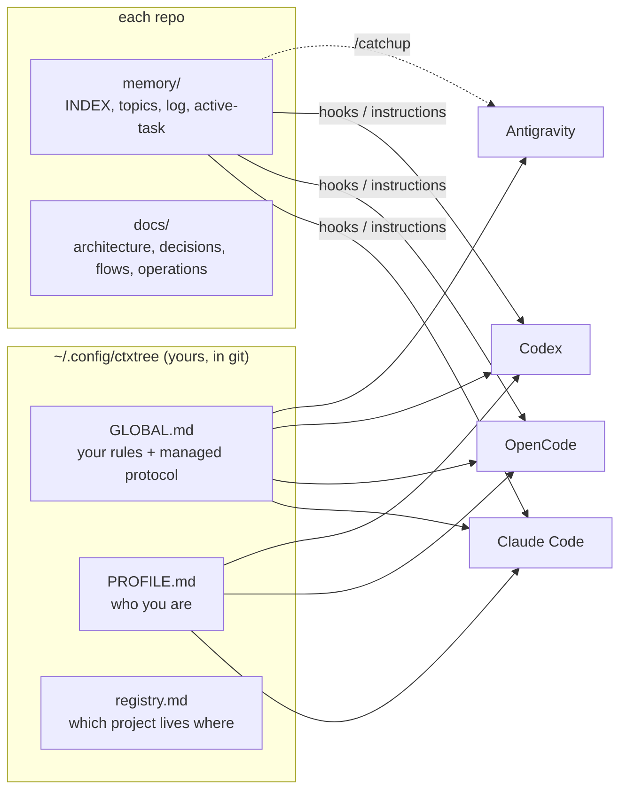

# ctxtree

One shared memory system for coding agents. Claude Code, OpenCode, Codex and Antigravity read the same rules, the same user profile and the same per project memory, keep that memory in sync with the code, and share the same slash commands.

A model forgets everything between sessions. Memory is only the files that get put back into its context. This pack gives every kind of fact exactly one home and gives every home something that loads it.



## What you get

| Piece | What it does |
| --- | --- |
| `GLOBAL.md` | Your rules, symlinked into every agent. A managed block holds the memory protocol; upgrades replace only that block. |
| `PROFILE.md` | Your preferences, loaded in every session (import, instructions or hook, depending on the agent). |
| `memory/` tree | Per project facts, decisions and state: `INDEX.md` (always loaded, under 40 lines), topic files (on demand), `log.md`, `active-task.md` (planning with files), `archive/`. |
| Sync | Memory is "behind" when the repo has code commits newer than the last memory update. Session start shows a warning, the Stop hook asks once per session for an update, the git guard warns at commit. |
| Guardrails | Secrets in memory or global files block the commit; size limits, broken INDEX links and unordered logs warn; no memory or AGENTS.md above a project root; global files change only on request or confirmation. |
| Commands | `/catchup`, `/task`, `/learn`, `/promote`, `/memory-init`, `/project-docs` |
| Skills | `memory-tree` (the standard), `project-docs` (four docs with Mermaid, verified against code) |
| CLI | `ctxtree context, status, where, check, init, doctor` |

## Install

Open Claude Code, OpenCode or Codex and say:

> Install ctxtree on this machine by following INSTALL.md in <this repo>

The agent runs the steps in [INSTALL.md](INSTALL.md) and asks you once before changing anything.

### By hand

Requirements: bash, git and jq for the installer; only bash and git at runtime.

| Platform | Notes |
| --- | --- |
| Linux | any bash, GNU or busybox tools |
| macOS | the built in bash 3.2 works; jq ships with macOS 15 and later (`brew install jq` before that) |
| Windows | run from Git Bash (Git for Windows). Install jq: `winget install jqlang.jq`. Turn on Developer Mode for real symlinks; without it the installer writes managed copies that `ctxtree` refreshes at every session start. Codex hooks use the `ctxtree.cmd` shim so they run through Git Bash, never WSL |

```bash
git clone <this repo> ctxtree && cd ctxtree
./install.sh --dry-run          # see every action first
./install.sh                    # wires every agent whose config folder exists
ctxtree doctor                 # verify
```

Options (all platforms): `--agents claude,opencode,codex,antigravity`, `--link` (develop the pack in place), `--keep-auto-memory`, `--claude-plugin`, `--no-git-hook`, `--no-git`, `--uninstall [--purge]`. The installer backs up every file it replaces, records every change in a manifest, and reruns safely.

Your existing setup keeps working. Rules you already had in `CLAUDE.md`, `AGENTS.md` or `GEMINI.md` are copied into `GLOBAL.md`, so they still load. Your own commands, skills or prompts with the same name as ours stay in place. Your repositories' own git hooks (commit-msg, pre-push and the rest) still run after the ctxtree guard. Project `memory/` folders and Claude auto memory files are never touched. `--uninstall` puts every file back exactly as it was.

Then:

1. Fill in `~/.config/ctxtree/PROFILE.md` and the top of `GLOBAL.md`.
2. In a project, at its git root: `/memory-init` (or `ctxtree init <topic> ...`).
3. Work. Run `/learn` at milestones. Use `/task <goal>` for anything with more than three steps.

### Claude Code as a plugin

Instead of the installer wiring Claude's commands, skills and hooks:

```bash
./install.sh --claude-plugin     # still links CLAUDE.md and the profile
```

then in Claude Code: `/plugin marketplace add /path/to/ctxtree` and `/plugin install ctxtree@ctxtree`.

## How each agent is wired

| | Claude Code | OpenCode | Codex | Antigravity |
| --- | --- | --- | --- | --- |
| Rules | `~/.claude/CLAUDE.md` link | `~/.config/opencode/AGENTS.md` link | `~/.codex/AGENTS.md` link | `~/.gemini/GEMINI.md` link (also Gemini CLI) |
| Profile | `@` import in the managed block | `instructions` entry | SessionStart hook (`--profile`) | read at session start (rule) |
| Project memory | SessionStart hook | `instructions`: `memory/INDEX.md`, `memory/active-task.md` | SessionStart hook | `/catchup` |
| Sync check | SessionStart + Stop hooks, git guard | git guard, `/catchup` | SessionStart + Stop hooks, git guard | git guard, `/catchup` |
| Commands | `~/.claude/commands` | `~/.config/opencode/commands` | `~/.codex/prompts` (`/prompts:learn`) | `~/.gemini/config/global_workflows` |
| Skills | `~/.claude/skills` | `~/.agents/skills` | `~/.agents/skills` | `~/.gemini/config/skills` |

Codex asks you to approve new hooks once in `/hooks`. Antigravity hooks are not wired because their format is not documented yet. Claude Code auto memory is turned off because the tree replaces it (`--keep-auto-memory` to keep it).

## Where facts go

| Fact | Home | Who writes it |
| --- | --- | --- |
| How agents behave | `GLOBAL.md` (above the managed block) | you, or an agent after `/promote` and your yes |
| Your preferences | `PROFILE.md` | same |
| Project decisions, state, ids | `memory/<topic>.md` | agents, the moment it becomes true |
| The task in flight | `memory/active-task.md` | agents, after every phase |
| What happened when | `memory/log.md` | agents, one line per session |
| Stable explanation for humans | `docs/*.md` | `/project-docs` |
| Which project lives where | `registry.md` | `ctxtree init` |

## Tests

```bash
bash tests/run.sh          # 116 checks in a throwaway HOME; never touches yours
bash tests/live-smoke.sh   # optional: real Claude Code and OpenCode, a few model calls
```

CI (`.github/workflows/test.yml`) runs the suite on ubuntu, macos and windows runners and under bash 3.2 with busybox tools.

## Docs

- [Architecture](docs/ARCHITECTURE.md)
- [Decisions](docs/DECISIONS.md)
- [Flows](docs/FLOWS.md)
- [Operations](docs/OPERATIONS.md)
