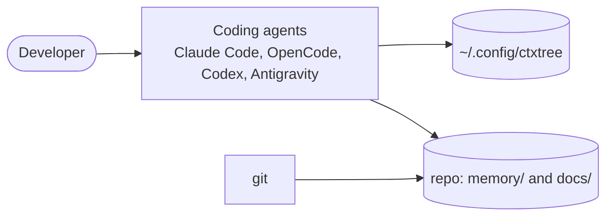
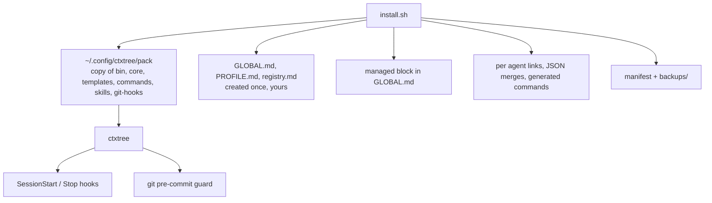

# Architecture

Last verified against the code: 2026-11-22. What the parts are and how they connect.

## Context

## Components

| Component | Responsibility | Lives in |
| --- | --- | --- |
| CLI | Lookup, sync check, hook output, guardrail lint, tree init, install check | `bin/ctxtree` |
| Installer | Copies the pack, creates user files once, refreshes the managed block, wires each agent, records a manifest, uninstalls | `install.sh` |
| Protocol | The rules every agent loads, rendered into the managed block of `GLOBAL.md` | `core/protocol.md` |
| Commands | Shared slash commands, adapted per agent at install | `commands/` |
| Skills | `memory-tree` and `project-docs` standards | `skills/` |
| Templates | GLOBAL, PROFILE, registry, memory tree, AGENTS.md, the four docs | `templates/` |
| Git guard | Global pre-commit: secrets block, size and stale warnings, chains the repo's own hook | `git-hooks/pre-commit` |
| Claude plugin | Alternative Claude wiring: commands, skills, hooks | `.claude-plugin/`, `hooks/hooks.json` |

## Data

- Global, user owned, in git: `GLOBAL.md`, `PROFILE.md`, `registry.md`, `notes/`. The installer only rewrites the text between `<!-- ctxtree:begin -->` and `<!-- ctxtree:end -->`.
- Global, pack owned, ignored by git: `pack/`, `backups/<time>/`, `manifest`, `agents`.
- Per project, committed with the code: `memory/` and `docs/`.
- Stop hook state: one small file per session under `$XDG_RUNTIME_DIR/ctxtree-<uid>/` holding the HEAD it last blocked on.

## Boundaries and constraints

- Lookup is the nearest `memory/INDEX.md` up to the git root and nothing else, because that is how OpenCode resolves relative instructions (verified live) and a second rule would split agents (D2).
- No database or MCP memory server: plain files are readable, diffable and shared by every agent (D1).
- Agents without hooks get memory through `/catchup` and the rule in the managed block; that is weaker and documented (D6).
