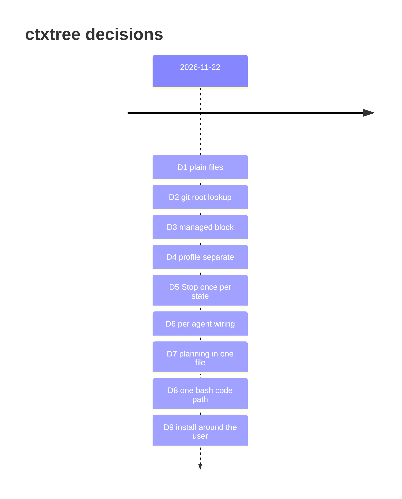

# Decisions

Why the pack is the way it is. Newest first. A changed decision gets a new record.

## D9: install around the user's setup, never over it (2026-11-22)

- Status: accepted
- Context: an audit against a HOME with an existing setup showed nothing was deleted, yet the user's rules stopped loading (backed up, replaced by a link to a blank GLOBAL.md), their own `/learn` and `memory-tree` were shadowed, and the global `core.hooksPath` silently disabled every repo hook except pre-commit (commit-msg, git lfs pre-push).
- Decision: rules found in an agent's rules file are imported into the user section of GLOBAL.md under a checksum marker (once per distinct content, ctxtree blocks stripped). A foreign command, skill or prompt with one of our names is kept and named in the output. `git-hooks/` has a wrapper for every hook name that hands off to the repo's own hook through `_run-local`, except hooks whose mere presence changes git (push-to-checkout, proc-receive, fsmonitor-watchman). JSON files the installer created are removed on uninstall when empty.
- Alternatives: append an import line to each rules file instead of linking (no import syntax in Codex AGENTS.md); leave the migration to the agent (silent breakage when it skips the step); make the git hook opt in (loses the secret guard by default).
- Consequences: a kept item means that agent runs the user's version, not ours; the import may bring an older memory protocol along, which INSTALL.md step 5 offers to trim. Every hook name costs one tiny shell start when git runs it.

## D8: one bash code path for Linux, macOS and Windows (2026-11-22)

- Status: accepted
- Context: macOS ships bash 3.2 and BSD tools; Windows agents run hooks through Git Bash (Claude), PowerShell or cmd (OpenCode, Codex); Git Bash copies instead of linking unless Developer Mode is on.
- Decision: runtime needs only bash 3.2 and git (no jq, no GNU only flags); paths written into agent config use the native form (`cygpath -m`); hook commands are `bash "<path>"`, and on Windows Codex uses a `.cmd` shim that calls Git Bash by full path; where symlinks fail, managed copies are refreshed by `ctxtree` at every session start.
- Alternatives: rewrite in Node or Python (not present on every machine these agents run on); plain copies (drift, the original problem).
- Consequences: one implementation, tested under bash 3.2 plus busybox locally and on all three OS runners in CI.

## D7: planning with files in one active-task.md (2026-11-22)

- Status: accepted
- Context: othmanadi/planning-with-files shows that a plan on disk survives context loss; it uses three files and injects again the plan on every prompt.
- Decision: one `memory/active-task.md` with Goal, Phases, Findings, Decisions, Errors; rules: save findings every two reads or searches, read it again before decisions, log every failure, ask after three; delete when done.
- Alternatives: three files (more to load and keep consistent); per prompt injection (context cost on every message).
- Consequences: cheap and resumable; relies on the rule plus SessionStart injection rather than per prompt hooks.

## D6: wire each agent with its documented mechanism (2026-11-22)

- Status: accepted
- Context: agents differ: Claude imports files and has hooks; OpenCode has an `instructions` list; Codex has hooks but no imports; Antigravity hooks are undocumented.
- Decision: rules are one symlinked file everywhere; profile and memory use each agent's strongest documented loader (see README table). Codex hooks need a one time trust in `/hooks`.
- Alternatives: generated per agent copies (they drift, the original problem); a shared MCP server (loads only when the model decides to call it).
- Consequences: Claude, OpenCode and Codex load memory automatically; Antigravity relies on `/catchup`.

## D5: the Stop hook blocks once per session per code state (2026-11-22)

- Status: accepted
- Context: in the live test, a stale tree made the Stop hook block; blocking at the end of every turn would nag.
- Decision: remember the HEAD the hook last blocked on per session; block again only after new commits.
- Consequences: one firm reminder per change; the session start warning and git guard remain.

## D4: the profile is a separate file (2026-11-22)

- Status: accepted
- Context: rules may be shared or published; the profile holds personal details.
- Decision: `PROFILE.md` next to `GLOBAL.md`, loaded by import, instructions or hook.
- Consequences: rules can be shared without leaking personal data.

## D3: user owned GLOBAL.md with a managed block (2026-11-22)

- Status: accepted
- Context: users need their own global rules; the pack needs to update its protocol.
- Decision: one file, symlinked into every agent; upgrades rewrite only the block between markers.
- Alternatives: two files (needs imports, which Codex and OpenCode rules files lack); overwrite on upgrade (destroys user rules).

## D2: lookup is the nearest memory/INDEX.md up to the git root (2026-11-22)

- Status: accepted
- Context: a cross workspace link map (a code repo loading memory from another folder) was tried and rejected as a personal special case.
- Decision: one generic rule, the one OpenCode already applies, verified live from a subfolder.
- Consequences: nested repos do not see a parent tree; start the agent where the tree lives.

## D1: memory is plain Markdown files in the repo (2026-11-22)

- Status: accepted
- Context: private tool memories and an MCP database duplicated facts, loaded only when the model chose to, and could not be reviewed.
- Decision: `memory/` committed with the code; global files in a git repo; no memory server.
- Consequences: every change is a diff; any agent that reads files can use it.
