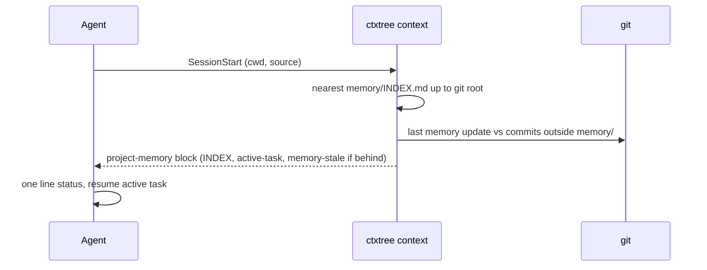
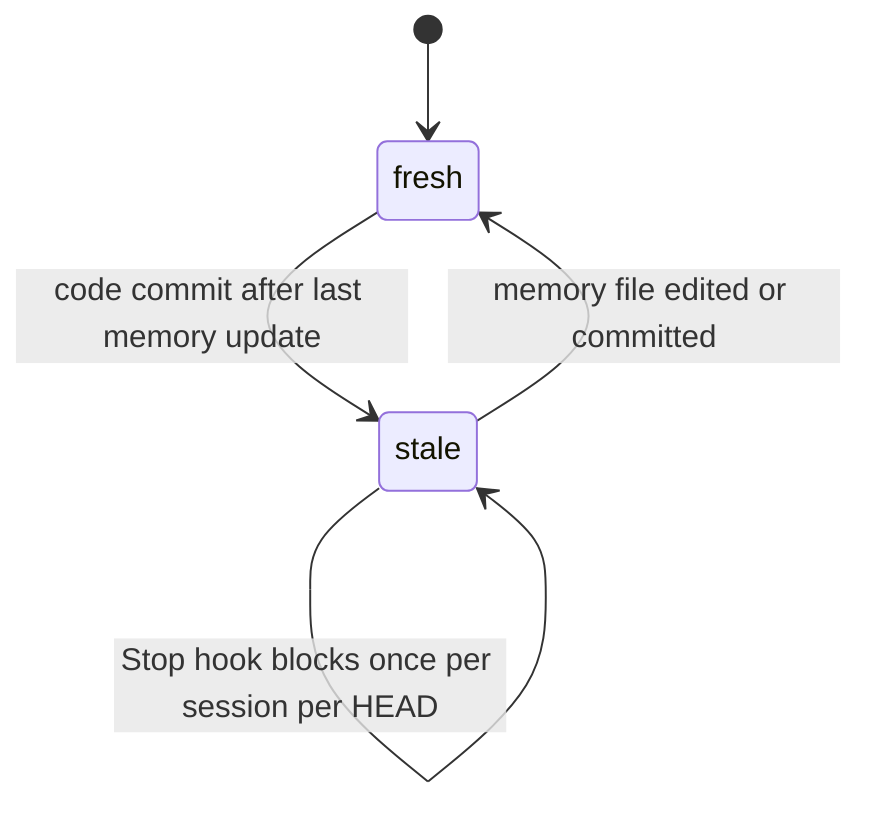
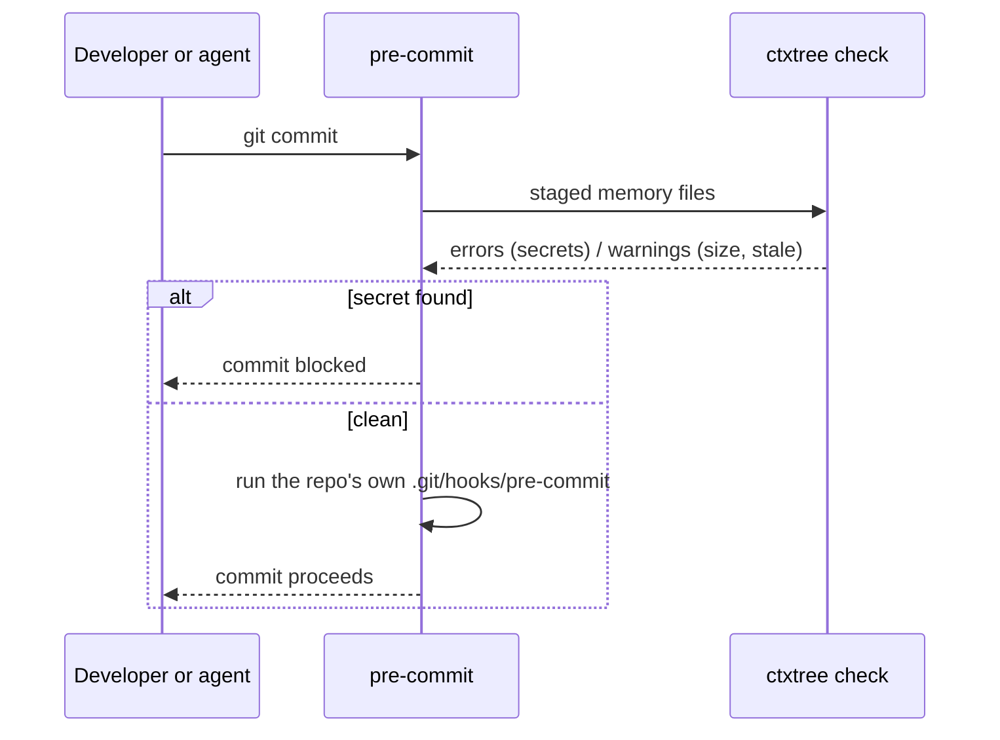
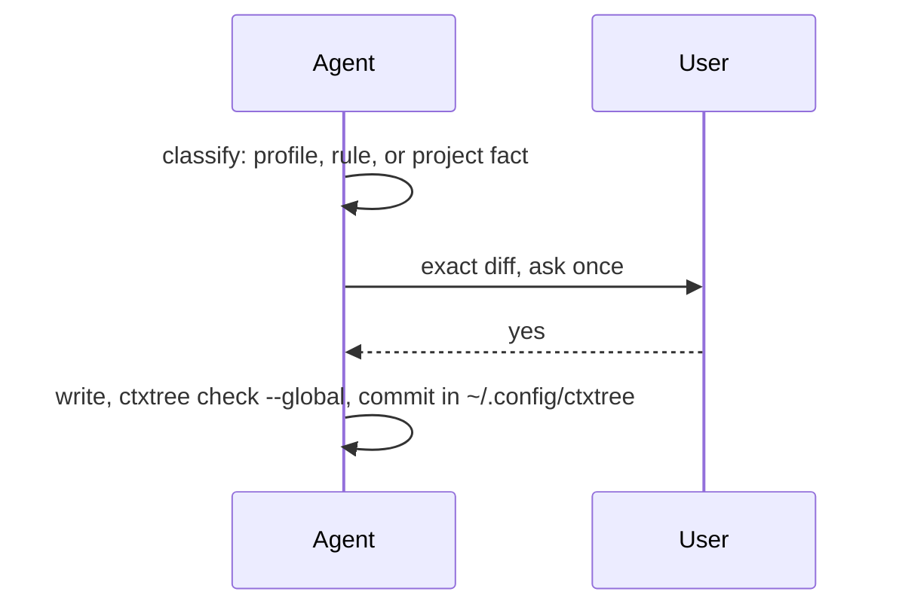
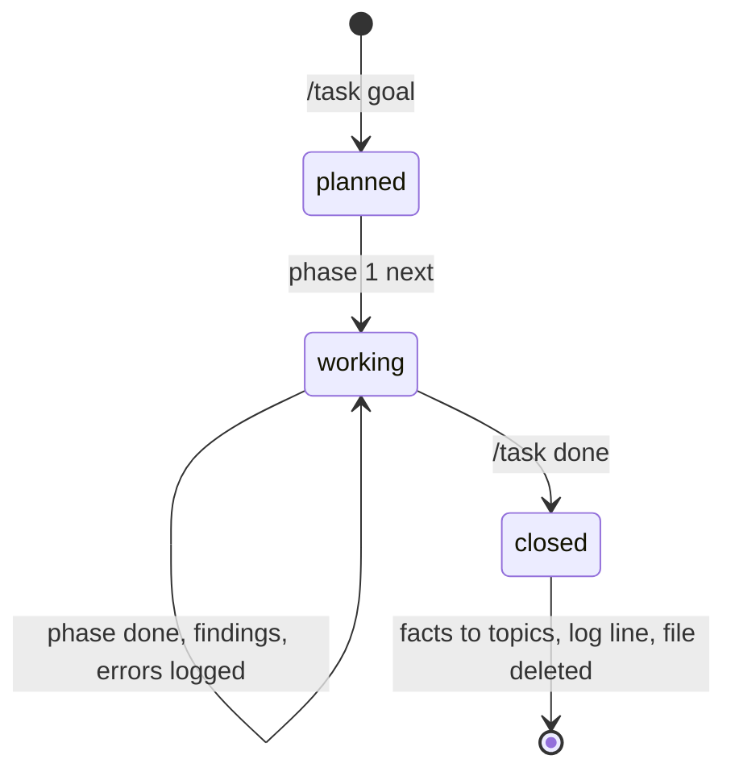

# Flows

## Session start (Claude Code, Codex)

OpenCode gets INDEX and active-task through `instructions`; Antigravity through `/catchup`.

## Keeping memory in sync

Signals while stale: `<memory-stale>` at session start, one Stop block per session and code state, a warning from the git guard on each code commit without memory changes.

## Commit guard

## Global change (/promote)

## Active task lifecycle

