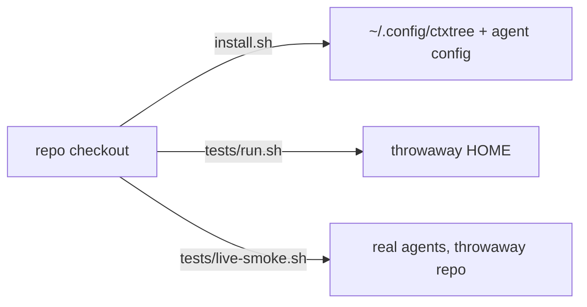

# Operations

Last verified against the code: 2026-11-22.

## Environments



## Install, update, remove

```bash
./install.sh --dry-run
./install.sh                       # or --agents claude,opencode
./install.sh                       # rerun after git pull to update the pack and managed block
./install.sh --link                # while developing the pack
./install.sh --uninstall           # restores backups, keeps your GLOBAL/PROFILE
./install.sh --uninstall --purge   # also deletes ~/.config/ctxtree
ctxtree doctor
```

## Test

```bash
bash tests/run.sh
bash tests/live-smoke.sh
```

## When it breaks

| Symptom | Likely cause | Fix |
| --- | --- | --- |
| Agent does not know the project state | started outside the repo, or in a nested repo | start at the repo; `ctxtree where` shows the root it finds |
| `<memory-stale>` every session | memory never updated after code commits | `/learn`, or refresh INDEX's date if status did not change |
| Codex ignores the hooks | hooks not trusted yet | open Codex, run `/hooks`, approve |
| Commit blocked by ctxtree | a secret value in a memory file | replace the value with where it lives |
| `SKIP ... not plain JSON` during install | `opencode.json` or `settings.json` has comments | add the entries by hand (README wiring table) |
| A file you had was replaced | installer link | it is in `~/.config/ctxtree/backups/<time>/`; `--uninstall` restores it |
| Windows: rules not updated in an agent | Developer Mode off, so the rules are managed copies | they refresh at the next session start; force with `ctxtree sync`; or enable Developer Mode and reinstall |
| Windows: Codex hook runs WSL bash | `bash` on PATH resolves to WSL | the installer uses `ctxtree.cmd`, which calls Git Bash by full path; set `CTXTREE_BASH` to override |
| Windows: `bad interpreter` or `\r` errors | scripts checked out with CRLF | `.gitattributes` forces LF; run `git add --renormalize .` in an old clone |
| git hooksPath already set | you have your own global hooks | add `"<pack>/bin/ctxtree" check --staged \|\| exit 1` to your pre-commit |
