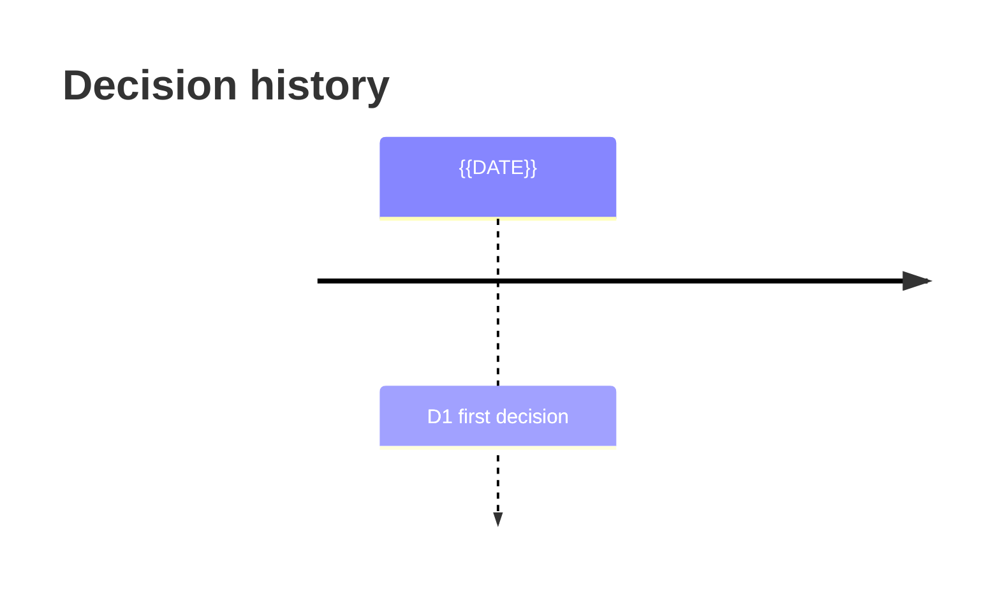

# Decisions

Why the system is the way it is. One entry per decision, newest first. Never rewrite an old decision; supersede it with a new one and link back.

## D1: <decision title> ({{DATE}})

- Status: accepted | superseded by Dn
- Context: <the problem and the forces at play>
- Decision: <what was chosen>
- Alternatives: <what else was considered and why not>
- Consequences: <what this makes easy, what it makes hard>
