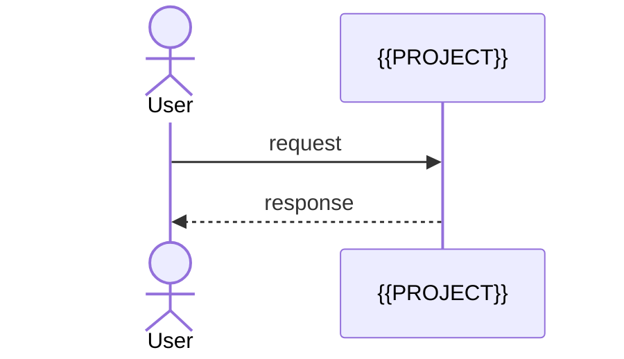
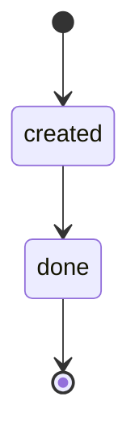

# Flows

What happens, step by step, for the flows that matter. One sequence per flow, one state diagram per lifecycle. Name the real components from `ARCHITECTURE.md`.

## <Flow name>

What can fail at each step and what the user sees.

## <Entity> lifecycle

