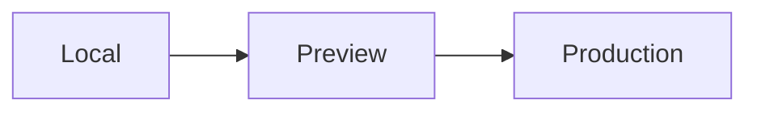

# Operations

How to set up, run, deploy and fix {{PROJECT}}. Commands are copy and paste ready. Secrets: name where each lives, never the value.

## Environments



| Environment | Address | Config | Secrets live in |
| --- | --- | --- | --- |
| Local | | | |

## Setup and run

```bash
<install command>
<run command>
<test command>
```

## Deploy and roll back

## When it breaks

| Symptom | Likely cause | Fix |
| --- | --- | --- |
